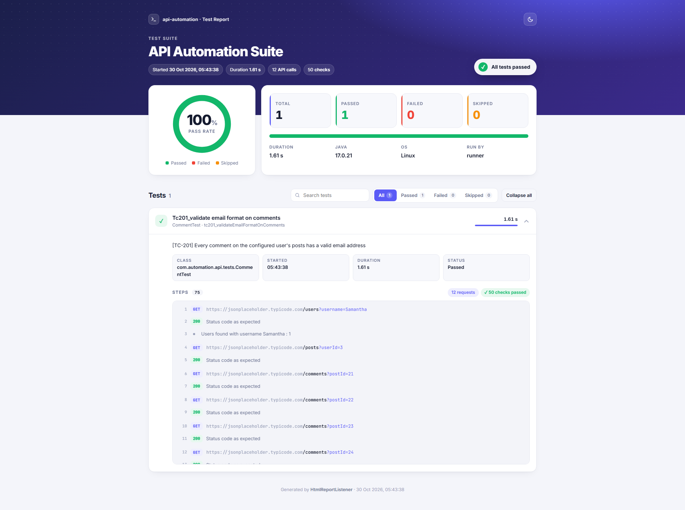
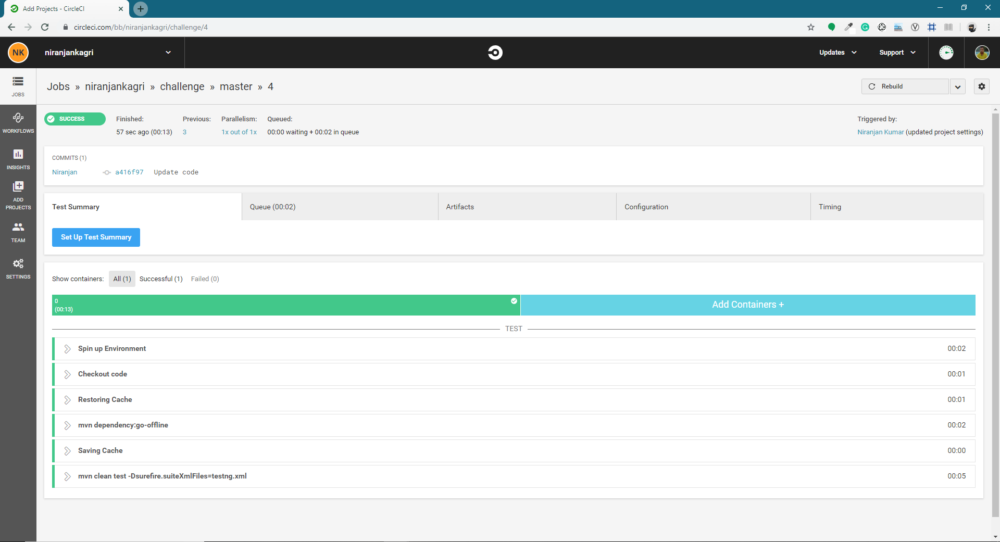

# api-automation

[](https://github.com/niranjankagri/api-automation/actions/workflows/tests.yml)

A REST API test automation framework built with **Java 17**, **REST Assured** and **TestNG**.

It tests the public [JSONPlaceholder](https://jsonplaceholder.typicode.com) API. The included test finds a user by username, fetches every post that user wrote, fetches every comment on those posts, and checks that each comment's email address is correctly formatted.

## Tech stack

| Tool | Purpose |
|------|---------|
| Java 17 | Language |
| Maven | Build and dependency management |
| TestNG | Test runner, assertions and soft assertions |
| REST Assured | Sending HTTP requests |
| Jackson | Mapping JSON responses onto Java objects |
| Log4j2 | Logging to the console and `applog.txt` |
| GitHub Actions, CircleCI | Continuous integration |

## Project structure

```
api-automation
├── .github/workflows/tests.yml     GitHub Actions: runs `mvn clean test` on every push
├── .circleci/config.yml            CircleCI pipeline: runs `mvn clean test`
├── docs/images                     Screenshots used in this README
├── pom.xml                         Maven dependencies and plugins
├── testng.xml                      TestNG suite (list of test classes to run)
└── src
    ├── main/java/com/automation/api
    │   ├── builder
    │   │   ├── RequestBuilder      Sends HTTP requests
    │   │   └── ResponseBuilder     Maps JSON responses onto Java objects
    │   ├── constants
    │   │   ├── StatusCode          Expected HTTP status codes
    │   │   └── URL                 Base URL and endpoint paths
    │   ├── listeners
    │   │   └── HtmlReportListener  Generates the custom HTML test report
    │   ├── manager                 One class per API resource
    │   │   ├── Manager             Base class: send request, assert status, map JSON
    │   │   ├── UserManager         /users
    │   │   ├── PostManager         /posts
    │   │   └── CommentManager      /comments
    │   ├── response                POJOs for the JSON responses
    │   │   ├── User
    │   │   ├── Post
    │   │   └── Comment
    │   ├── testdata
    │   │   └── TestDataLoader      Test data from data.properties (overridable with -D)
    │   └── utils
    │       ├── PropertiesReader    Loads .properties files from the classpath
    │       └── Util                Email validation and logging
    ├── main/resources
    │   └── log4j2.properties       Logging configuration
    ├── test/java/com/automation/api/tests
    │   ├── BaseTest                Parent class of all tests
    │   └── CommentTest             Email format test on comments
    └── test/resources
        └── data.properties         Test data (e.g. username)
```

## How it works

The framework has three layers:

1. **Tests** (`tests`) describe the scenario in business terms and contain no HTTP code.
2. **Managers** (`manager`) wrap one API resource each and return Java objects. The shared steps (send the request, log and assert the status code, map the JSON) live in the `Manager` base class.
3. **Builders** (`builder`) do the low-level work: `RequestBuilder` sends requests with REST Assured, and `ResponseBuilder` turns JSON into POJOs with Jackson.

Test classes extend `BaseTest`, which provides the managers (`userManager`, `postManager`, `commentManager`) and the test data (`testData.getUsername()`).

### Test scenario TC-201: `CommentTest.tc201_validateEmailFormatOnComments`

Written out for a manual run (setup, steps, expected results) in [docs/manual-test-cases.md](docs/manual-test-cases.md). Test methods start with their case ID (`tc201_...`).

1. Search for the user by the username in `data.properties` (`GET /users?username=Samantha`) and assert that exactly one user matches.
2. Get all posts written by that user (`GET /posts?userId={id}`).
3. Get all comments on each post (`GET /comments?postId={id}`).
4. Check every comment's email against an email regex. A soft assert collects all failures, so one run reports every badly formatted email.

## Prerequisites

- JDK 17 or newer
- Maven 3.6 or newer
- Internet access (the tests call the live JSONPlaceholder API)

## Running the tests

From the project root:

```bash
mvn clean test
```

Maven runs the suite in `testng.xml`. Results are written to:

- `target/surefire-reports/api-test-report.html`: the custom HTML report (see below)
- `target/surefire-reports/`: standard TestNG/Surefire reports
- `applog.txt`: the full request and assertion log

Any test data value can be overridden on the command line without editing `data.properties`:

```bash
mvn clean test -Dusername=Bret
```

To run from an IDE, right-click `testng.xml` or `CommentTest` and choose **Run**.

## HTML report

`HtmlReportListener` (registered in `testng.xml`) writes a single self-contained HTML file, `api-test-report.html`, after each run. Open it in any browser; it needs no other files, so it can be shared or archived on its own.

It shows:

- a header with the suite name, start time, duration, number of API calls and checks, and an overall verdict
- a pass-rate ring, passed/failed/skipped/total counts with a stacked result bar, and the Java version, OS and user
- one expandable card per test with its status, a readable title, its description, and a duration bar scaled to the slowest test
- every step logged with `Util.logInfoMessage(...)` during the test, formatted by type:
  - `GET https://...` steps show an HTTP method badge and a highlighted URL
  - status code steps show a green or red code chip
  - `<text> : true|false` steps show as passed or failed checks
  - any other message shows as a plain info line
- the error type, message and a collapsible stack trace for failed tests (failed tests open automatically), and the reason for skipped tests
- a search box, status filters, an expand/collapse-all button and a light/dark theme toggle

By default the report follows the system theme; the toggle remembers the viewer's choice. It also prints cleanly. It is written to TestNG's output directory: `target/surefire-reports/` with Maven, or `test-output/` when run from the IDE.



## Configuration

| What | Where |
|------|-------|
| Username under test | `src/test/resources/data.properties` → `username`, or `-Dusername=...` |
| Base URL and endpoints | `src/main/java/com/automation/api/constants/URL.java` |
| Email format rule | `Util.EMAIL_REGEX` |
| Log format and output | `src/main/resources/log4j2.properties` |

## Adding a new test

1. Add the endpoint to `URL`.
2. If the response is a new resource, add a POJO under `response`.
3. Add a manager under `manager` that extends `Manager`. Use `get(uri, expectedStatusCode)` for a raw response or `getList(uri, Pojo.class)` for a list of objects.
4. Add a field for the new manager in `BaseTest`.
5. Write a test class under `tests` that extends `BaseTest`.
6. Add the test class to `testng.xml`.

## Continuous integration

`.github/workflows/tests.yml` runs the suite on GitHub Actions on every push and pull request (JDK 17, Maven cache) and keeps the HTML report and `applog.txt` as the run's **test-report** artifact; the badge at the top shows the latest result. The JUnit XML is kept as the separate **junit-api** artifact, which [Automation Coverage & Quality Intelligence](https://github.com/niranjankagri/automation-coverage-quality-intelligence) collects.

CI also runs every Monday at 23:15 UTC without a code change, so a broken dependency or a change outside the repository shows up within a week. Dependabot proposes dependency and GitHub Actions updates once a month (minor and patch updates grouped, major versions as separate pull requests).

`main` is protected by a ruleset: every change goes through a pull request, and this CI job must pass before it is merged.

`.circleci/config.yml` runs the suite on every push using the `cimg/openjdk:17.0` image, caching Maven dependencies between builds. Test results appear in the CircleCI **Tests** tab, and the HTML report and `applog.txt` are saved as build **Artifacts**. A sample run is shown below.



## License

[MIT](LICENSE)
